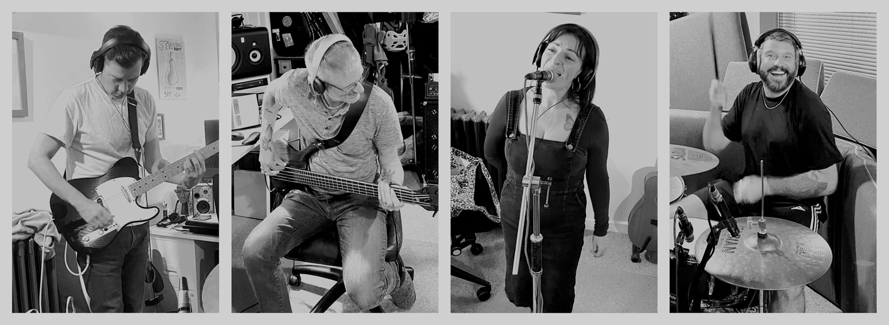

+++
title = "Press Pack"
description = "Information for people booking Article for gigs"
no_header_image = true
+++

What began as a chance connection between bassist Will Gibson and guitarist Dan Healy on a workplace Slack channel for musicians has evolved into one of the most exciting heavy alt-rock prospects on the circuit.

Now a powerhouse four-piece completed by the vocals of Charlotte Louisa and drummer Ebn Mars, Article delivers a colossal sound that balances raw power with artistic depth. 

Article's music weaves the legendary riff-heavy swagger of Led Zeppelin and AC/DC with the sharp, confrontational edge of Skunk Anansie and PJ Harvey. Known live for radically reinventing tracks you thought you knew, Article is currently locked in the studio recording a brand-new album of entirely original songs designed to be completely unforgettable.

## Social media

- [Facebook](https://www.facebook.com/ArticleBand)
- [Instagram](https://www.instagram.com/article.a.band/)
- [Blue Sky Social](https://bsky.app/profile/article-band.bsky.social)
